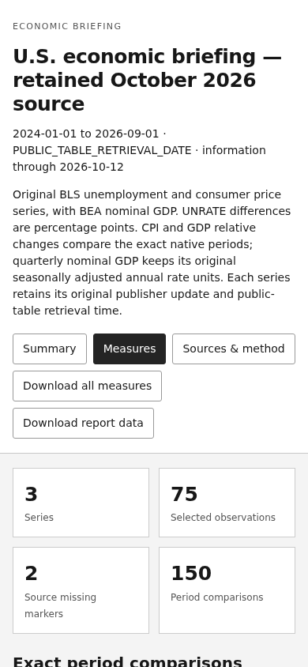

# SCF grant application: complete responsive receiving

Operation: `DCE4-SCF-GRANT-APPLICATION-RECEIVING-20261012`.

This directory contains the complete 75-file grant application source selection, its original browser receiving program, and the economic report correction found during the actual grant review. It opens the complete application, visits the manuscript sections and downloads, reads the economic report at desktop and phone widths, and packages the application, native result, browser captures and A4 PDF together.

## Run the complete original receiving

Keep this directory intact. Select an existing Node executable, installed Playwright module and Chromium executable on the accepting host. Python 3 uses its standard library. The earlier native run used Node 24.19.0 and Chromium 155.0.8059.39.

```sh
python3 /actual/checkout/experiments/grant-responsive-receiving-6cf6-20261012/run-native.py \
  --capsule /actual/checkout/experiments/grant-responsive-receiving-6cf6-20261012/responsive-grant-capsule.json \
  --directory /actual/private/original-grant-receiving \
  --node /actual/node \
  --playwright-module /actual/playwright/index.js \
  --chromium /actual/chromium
```

Use the selected private operation directory throughout this receiving. The program records the original listener, source selection and attempts, excludes concurrent owners with a process lock, and reopens a completed result only after checking its archive. It writes each selected source member once and accepts existing members only when their bytes agree. A restored earlier source selection must be composed with this explicit revision before it is launched in that same directory.

The capsule is already materialized; the command needs no repository checkout expansion or application dependency installation. It restores all 75 files, starts the original grant server, calls the original `inspectGrantApplication` program and produces the portable review ZIP. Use an installed Node runtime supporting this source's native APIs.

## Exact source selection

| Item | Identity |
| --- | --- |
| Base application | `e6a15209e5d8877ac4261f77e66eb859e035b842` |
| Original receiver merge | `0065bc2f3d5d0fb82176b4ea3f1602a3c7bfe8e1` |
| Original 75-file capsule | `1a8ac6e5de32faf688d640218da2d1747c27d295` |
| Complete responsive capsule | `2c9ae94bd53aa3aa0dbd6422ac35c8e3b14d43fb` |
| Capsule bytes | 1722772 |
| Capsule SHA256 | `d9d567e5158d5b3b03d905659ee08a37f782b0b4dffd7621099a8f625b3d9ca2` |
| Explicit source revision | `DCE4-SCF-GRANT-RESPONSIVE-RECEIVING-20261012` |

The revision carries one coherent V2 economic presentation: responsive HTML, updated report manifest, updated guide, updated package manifest and regenerated source ZIP. All 15 ZIP members are present. The source index lists exact base and successor identities. The retained report JSON, measures CSV, capture, review, calculated values and report identity remain identical to the original selection.

The browser program checks that the comparison region can receive keyboard focus and scroll horizontally at phone width. Its wait for the browser's scroll update has an explicit five-second timeout.

## Native findings and corrected report

The original application run on 12 October 2026 at 15:14 UTC reached the economic phone view after visiting the grant sections, source downloads, desktop views and PDF export. The economic series selector expanded a 390px page to 606px. The retained original result records this exact failure.

The correction makes the filter controls shrink and wrap with their container and labels the comparison table as a keyboard-focusable region. Actual Chromium measurements covered Summary, Measures and Sources at widths 320, 390, 700 and 1440. All 12 views fit their viewport; the comparison table retains horizontal scrolling for its complete columns. The diagnostic measured a 356px table viewport over 1262px of content and scroll position 200, with zero page errors.



The retained capture is 53,530 bytes with SHA256 `7a7cd411536bdd3b1a5a9c7dc8b2231b0879ca67ab9b497bf13fa822687e1572`. The original attempt and complete layout measurements are in `responsive-correction/`. A subsequent complete receiving opened with the corrected source before its host disconnected. The existing local receiving request continues this same grant operation using the full selection supplied here.

The five generated asset identities were reproduced byte for byte from the original source. The final capsule additionally carries the explicit keyboard-scroll timeout in the receiver.

## Delivery and source integration

The accepting host returns `last-result.json` and its complete `deliveries/SCF_Grant_Visual_Receiving_<attempt>.zip`. The archive includes the exact restored application, selected capsule, source manifest, native attempt, nine browser captures, A4 PDF, downloaded source files and the retained responsive correction. The native receiving result identifies the completed views and files. Preserve the operation directory for continuation.

The maintained FRED source changes are included in `responsive-correction/fred-report.mjs` and `fred-files.mjs`. They add the responsive V2 renderer and retain compatibility with saved V1 report files. Owner 9B2C accepted these two source leaves in the original FRED receiving thread for integration with E274's cumulative release.

Original grant thread: https://tokenjunkielabs.slack.com/archives/C0BTB4SUCP9/p1791730220899469

FRED source delivery and owner acceptance: https://tokenjunkielabs.slack.com/archives/C0BTB4SUCP9/p1791819402628869?thread_ts=1791764934.645359

Portable original builder: https://tokenjunkielabs.slack.com/docs/T0BRETUB5TK/F0C9F1CLJBS
